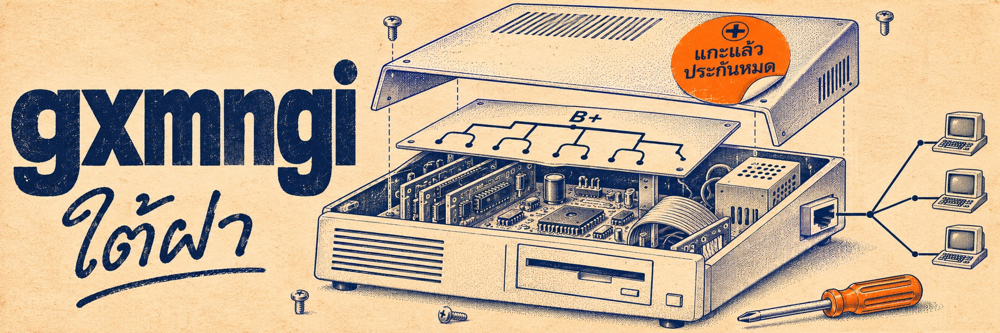

**I wanted to know what `git commit` writes to disk. So I built it.**

ผมชื่อ Rusdan ครับ เวลาใช้เครื่องมือแล้วสงสัยว่าข้างในมันทำงานยังไง ผมชอบลองเขียนส่วนนั้นขึ้นมาเอง

### เปิดฝาดู

- ตอนพิมพ์ `git commit` อะไรถูกเขียนลงดิสก์? ลองไล่จากไฟล์หนึ่งไฟล์ไปถึง blob, tree และ commit ใน [minigit-py · Python](https://github.com/gxmngi/minigit-py)
- ถ้าไฟดับกลางคัน ฐานข้อมูลรู้ได้ยังไงว่าต้องกู้อะไร? เปิดดู write-ahead log กับหน้า B+Tree ใน [lithos-db · Rust](https://github.com/gxmngi/lithos-db)
- ไฟล์เดียวประกอบกลับมาจากหลาย peer ได้ยังไง? ตามดูตั้งแต่ขอบล็อกแรกจนตรวจ hash ของแต่ละชิ้นใน [vortex-torrent · Go](https://github.com/gxmngi/vortex-torrent)
- จาก `git push` ถึง URL ที่เปิดได้ เกิดอะไรขึ้นระหว่างทาง? ตามงานจากคิว build เข้า container จนถึง reverse proxy ใน [stratus-cloud · Go & TypeScript](https://github.com/gxmngi/stratus-cloud)

**Rusdan Lamsa** · Systems & full-stack engineer · IT at Walailak University · Former SWE intern at MFEC · [LinkedIn](https://www.linkedin.com/in/rusdanlamsa/)
